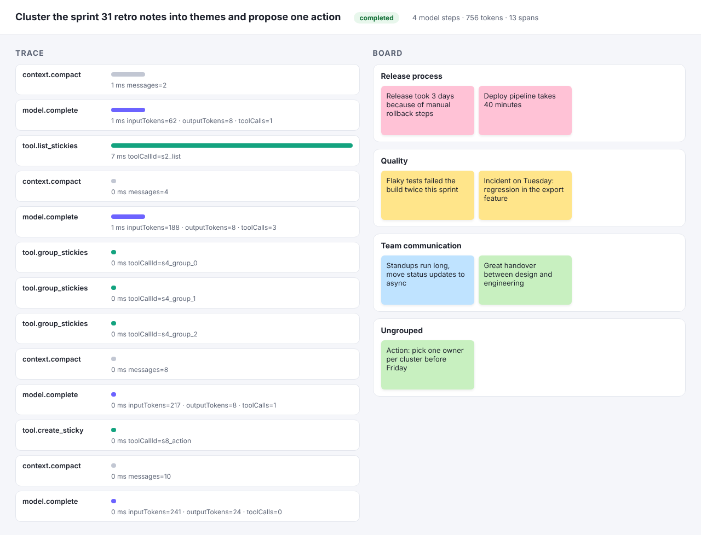
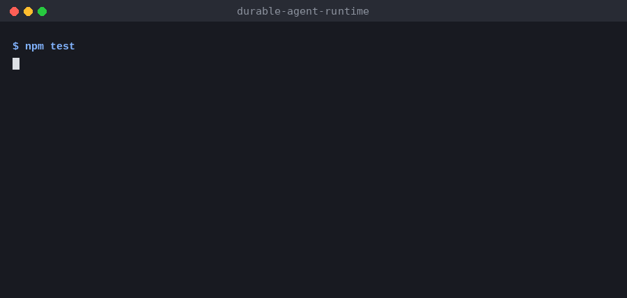

# durable-agent-runtime

Agents that act on a shared whiteboard have to survive real conditions: a worker restarting mid-run, a model calling the same tool twice, a conversation growing past the context window. This runtime runs those agents durably on MongoDB and records every step, so you can see what happened and resume from where it stopped.





## How a run works

1. `POST /boards/:boardId/runs` stores a run with the goal and returns `202`. A worker picks it up straight away.
2. The worker **claims a lease** on the run (an atomic `findOneAndUpdate`), so only one worker drives a run at a time. Checkpoints renew the lease. A worker whose lease expired can no longer write: its saves are fenced by the lease owner.
3. Each loop iteration compacts the context if needed, calls the model, executes any tool calls and **checkpoints after every step**.
4. When the model answers without tool calls, the run completes with its output and full trace.

If a worker dies mid-run, the run stays `running` with an expired lease. Another worker, or `POST /runs/:id/resume`, picks it up from the last checkpoint. Tool calls that were issued but have no recorded result are executed again. Tools are written to be idempotent for exactly that case: `create_sticky` derives the note id from the tool call id, so a replay never creates a second note. A test kills the run right after a side-effecting tool call and checks that the resumed run finishes with exactly one action item.

## Design notes

- **Tools are typed at the boundary.** Each tool declares a zod schema. The registry publishes it to the model as JSON Schema and validates every call. Invalid arguments and tool failures go back to the model as tool results, so it can correct itself. Only model failures fail the run.
- **Context compaction keeps tool pairs intact.** When the conversation exceeds its token budget, older turns are replaced by a summary. The system prompt and the most recent turns are kept, and the cut always falls on a turn boundary, so a tool result is never separated from the call that produced it.
- **Observability is part of the run.** Every compaction, model call and tool call is a span with timings, token usage and tool call ids. `GET /runs/:id/trace` returns them, and `GET /runs/:id/view` renders them next to the board.
- **The model is a port.** `AzureOpenAIClient` speaks the Azure OpenAI chat completions API with tool calling. `ScriptedModel` makes tests, evals and the demo deterministic and free to run.
- **Evals run offline.** `npm run evals` replays board scenarios and scores grouping accuracy, step budget and the action item. Point it at Azure OpenAI with the environment variables below to evaluate a real deployment.

## Tech stack

Node.js 22, TypeScript (strict, erasable syntax only), Fastify, MongoDB, zod, Azure OpenAI, vitest, mongodb-memory-server, Docker, GitHub Actions

## Running it

```bash
npm ci
npm run dev                         # in-memory stores and the scripted model, http://localhost:3000
```

```bash
docker compose up --build           # MongoDB-backed
```

Try it:

```bash
curl -X POST localhost:3000/boards/retro/stickies -H 'content-type: application/json' \
  -d '{"id":"s1","text":"Release took 3 days because of manual rollback steps","color":"pink"}'
curl -X POST localhost:3000/boards/retro/runs -H 'content-type: application/json' \
  -d '{"goal":"Cluster the retro notes into themes and propose one action"}'
open http://localhost:3000/runs/<runId>/view
```

| Variable | |
| --- | --- |
| `PORT` | HTTP port, default `3000` |
| `MONGO_URL` | MongoDB connection string; in-memory stores when unset |
| `MONGO_DATABASE` | Database name, default `agent_runtime` |
| `WORKER_ID` | Lease owner id, default `worker-<pid>` |
| `AZURE_OPENAI_ENDPOINT`, `AZURE_OPENAI_DEPLOYMENT`, `AZURE_OPENAI_API_KEY` | Use Azure OpenAI instead of the scripted model |

## Tests

```bash
npm run typecheck
npm test          # unit, HTTP, MongoDB (in-memory server) and crash/resume tests
npm run evals
```

## License

MIT
